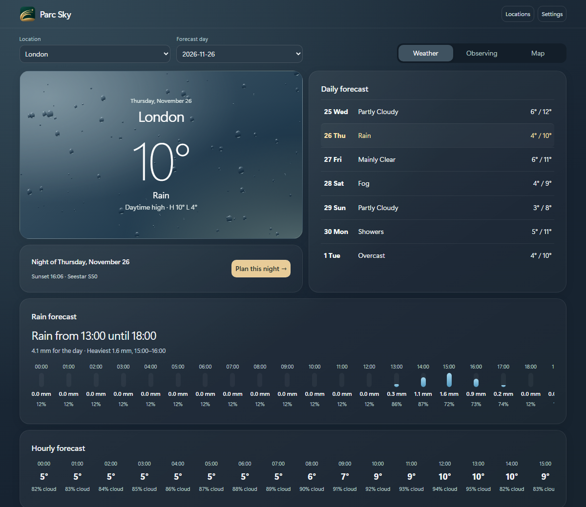
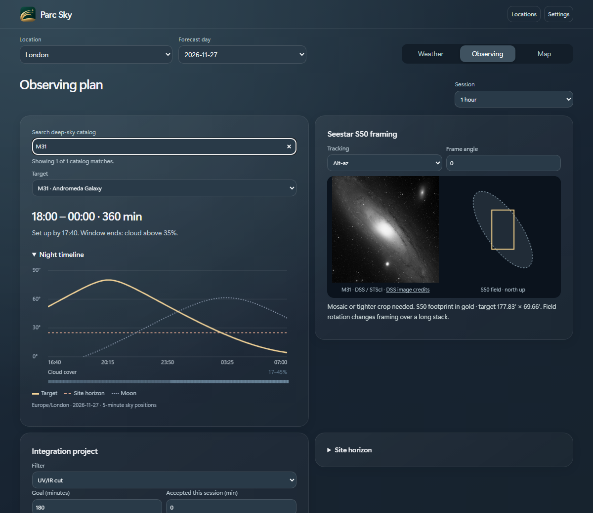
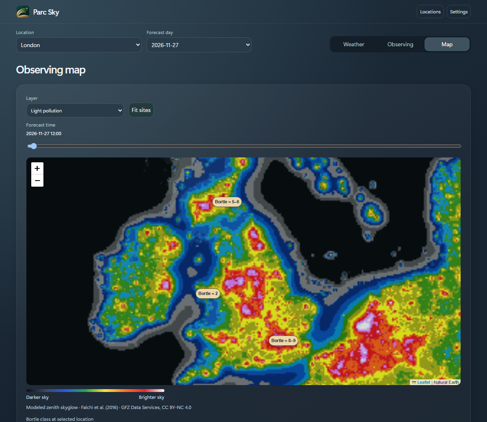

# Parc Sky

Parc Sky is a Windows weather and astrophotography planner for people who want to decide **where to shoot, what to frame, and when to start**. It brings the forecast and observing plan together, with a framing preview designed for the Seestar S50.

## Weather

See current conditions, a seven-day outlook, and hourly temperature and cloud cover. The rain forecast shows the next wet period, estimated rainfall, and hourly precipitation chances. Weather scenes animate with the conditions and respect reduced-motion preferences.



## Observing

Choose a forecast day and select **Plan this night**. Parc Sky checks astronomical darkness, cloud and rain, Moon proximity, and your saved horizon to suggest shooting windows. Search more than 12,000 deep-sky objects offline, preview the S50 field of view, and log accepted integration time across sessions.



## Map

Compare saved sites using temperature, cloud cover, rainfall, wind gusts, or modeled light pollution. Scrub through forecast hours and select a point to inspect local conditions. The light-pollution layer includes atlas-based Bortle estimates where covered. You can also record your own site observations.



Screenshots show sample forecasts for public locations. The light-pollution image uses the bundled 2016 skyglow atlas.

## Download

Get the [latest Windows x64 installer](https://github.com/samparchao/WeatherApp/releases/latest). It installs Parc Sky for your Windows user and adds a Start menu shortcut. Microsoft Edge WebView2 Runtime is required.

## Build and run

1. On Windows, install Visual Studio with WinUI 3 development support, the .NET 8 SDK, and the Microsoft Edge WebView2 Runtime.
2. Open [WeatherApp.sln](WeatherApp.sln), select **x64**, and run the **WeatherApp (Package)** profile.
3. Select **Locations** to add a site. You can also grant Windows location access to load your current area.

To compile a debug build without package signing:

```powershell
dotnet build .\WeatherApp\WeatherApp.csproj -p:Platform=x64 -p:AppxPackageSigningEnabled=false
```

The native shell is written in C# with WinUI 3. The interface runs locally in WebView2. Live forecasts and location searches need an internet connection. The regional basemap, light-pollution atlas and target catalog ship with the app.

## Location and data

Parc Sky stores saved sites, preferences, horizon profiles, and integration progress locally. Forecast requests send the relevant coordinates to Open-Meteo, and location searches and reverse geocoding use Nominatim. Observing windows and Bortle classes are planning estimates.

## Credits and licensing

Created by Samuel Teixeira Parchao. The [third-party notices](THIRD-PARTY-NOTICES.md) cover the forecast, geocoding, maps, catalog, and imagery sources. The bundled light-pollution and survey assets have non-commercial terms.
